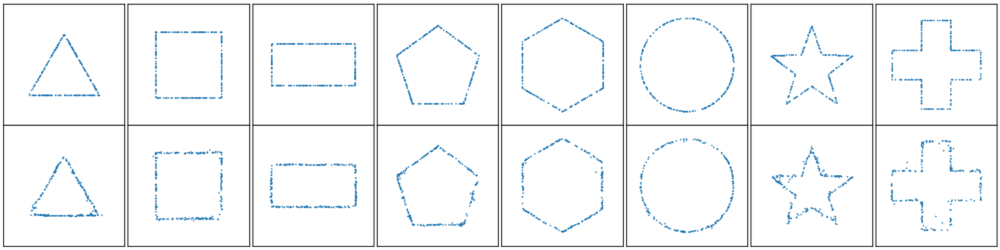
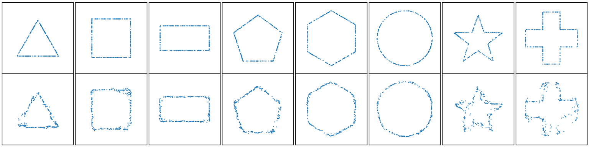
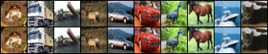
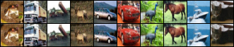

# Point Cloud Generation with Flow Matching

Flow-matching models for 2D point clouds and images, comparing **DiT** and **Point Transformer V3** across three prediction targets: clean data (**x**), noise (**ε**) and velocity (**v**).

Project Lab Deep Learning in Computer Vision, TU Darmstadt, WiSe 2026/27.

## Results

These first results test whether each model can memorise a small training set.

### Point clouds

Eight outline shapes with 256 points each. Lower is better.

| Prediction | Training steps | DiT Chamfer | PTv3 Chamfer | DiT EMD | PTv3 EMD |
|---|---:|---:|---:|---:|---:|
| x | 3000 | 0.00153 | 0.00221 | 0.0747 | 0.0774 |
| v | 3000 | **0.00092** | 0.00281 | 0.0694 | 0.0791 |
| ε | 6000 | 0.00142 | 0.00370 | 0.0720 | 0.0851 |

The top row shows the training shapes and the bottom row shows generated shapes.

**DiT, v-prediction**



**PTv3, x-prediction**



### Images

Ten CIFAR-10 images, x-prediction, 5000 training steps. Lower is better.

| Model | MSE |
|---|---:|
| DiT | **0.0004** |
| PTv3 | 0.0014 |

**DiT**



**PTv3**



## Quick start

```bash
conda create -n pcg python=3.11 -y
conda activate pcg
pip install torch torchvision matplotlib scipy

cd point-cloud-dit

# Point clouds
python train_benchmark.py --model dit --pred v --overfit 8
python train_benchmark.py --model ptv3 --pred x --overfit 8

# Images
python train_images.py --model dit --pred x --loss-space v
python train_images.py --model ptv3 --pred x --loss-space v
```

Score a trained point-cloud model:

```bash
python evaluate_benchmark.py --ckpt runs/benchmark/overfit/dit_v-pred_v-loss_seed0/ckpt.pt
```

## Repository

| Folder | Contents |
|---|---|
| `point-cloud-dit/` | Point-cloud and image models, training, evaluation and results |
| `flow-matching-dit/` | Initial DiT flow-matching experiments on images |

## References

- [Flow Matching for Generative Modeling](https://arxiv.org/abs/2210.02747)
- [Scalable Diffusion Models with Transformers](https://arxiv.org/abs/2212.09748)
- [Point Transformer V3](https://arxiv.org/abs/2312.10035)
- [Back to Basics: Let Denoising Generative Models Denoise](https://arxiv.org/abs/2511.13720)
